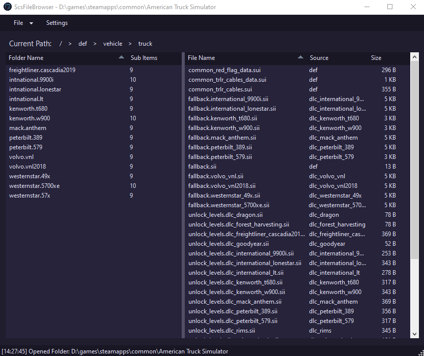

## ScsFileBrowser

### WIP

Simple application to extract files and folders from American Truck Simulator and Euro Truck Simulator 2 .SCS files without the need to extract the entire archive file.



### Building

There are two UIs sharing the same core code (archive reading, settings, logging):

- `ScsFileBrowser` - the original Windows Forms UI (Windows only, .NET 6).
- `ScsFileBrowser.Avalonia` - a cross platform [Avalonia](https://avaloniaui.net/) UI for Linux (also builds on Windows and macOS, .NET 8).

#### Linux (Arch)

```bash
sudo pacman -S dotnet-sdk git
git clone https://github.com/Callum-Bell/ScsFileBrowser
cd ScsFileBrowser

# Run directly (optionally pass an archive file or folder to open)
dotnet run --project ScsFileBrowser.Avalonia -c Release -- /path/to/base.scs

# Or publish a build you can start without the SDK
dotnet publish ScsFileBrowser.Avalonia -c Release -r linux-x64 --self-contained false -o out
./out/ScsFileBrowser.Avalonia
```

Notes:

- The project targets `net8.0` with roll forward enabled, so a newer installed SDK/runtime (9, 10) is fine. If restore complains about the `net8.0` targeting pack, install `dotnet-sdk-8.0` or change `TargetFramework` in `ScsFileBrowser.Avalonia/ScsFileBrowser.Avalonia.csproj`.
- The first build needs network access to restore the NuGet packages.
- Settings and logs are stored in `~/.local/share/TruckSim/ScsFileBrowser`.
- "Open With" starts the configured program with the extracted file as its only argument, so add native Linux programs (e.g. `/usr/bin/kate`) in the settings.
